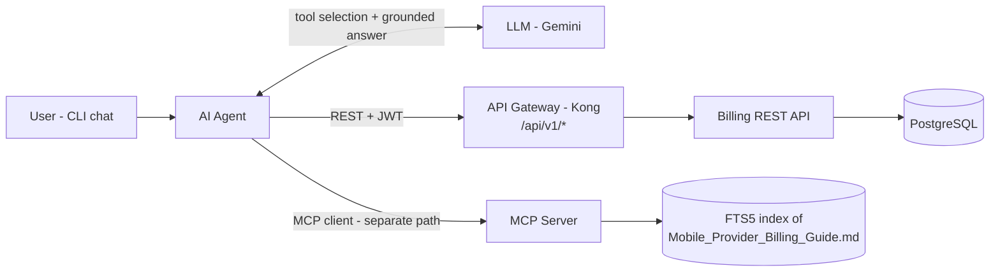
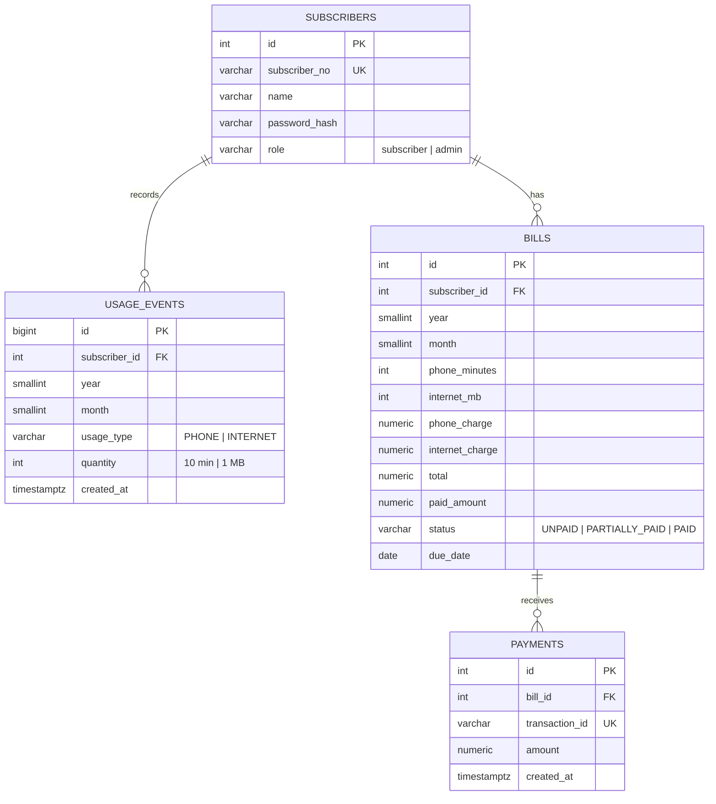

# AI Billing Support Assistant — SE 4458 Midterm 1 (Group 2)

A conversational assistant for mobile subscribers. It answers questions about billing rules, extra data charges, current bills and detailed usage, and it takes payments. It is built from four parts:

| Component | Technology | Folder |
|---|---|---|
| **AI Agent** (CLI) | Own agent loop on the OpenAI-compatible Chat Completions API with real tool/function calling — **Google Gemini** (free tier) by default, OpenAI optional; MCP client via the official MCP SDK | `agent/` |
| **MCP Server** | Official MCP TypeScript SDK; SQLite FTS5 + BM25 index of the billing guide; stdio and Streamable HTTP | `mcp-server/` |
| **Billing REST API** | Node.js 22 + TypeScript, Express 5, JWT, OpenAPI/Swagger, **PostgreSQL 16** | `billing-api/`, `db/` |
| **API Gateway** | Kong 3.9 (DB-less, declarative), with JWT, rate limiting and versioned routes | `gateway/` |

> Deployment URLs (Azure): _see [Cloud deployment](#cloud-deployment)_.

## Architecture



Agent workflow:

1. The user asks a question.
2. The LLM picks a tool (MCP and/or REST).
3. **The agent executes the call.** REST calls always go through the gateway.
4. The tool results go back to the LLM.
5. The LLM writes an answer grounded in those results and cites guide sections (e.g. *Guide §3.2*).

The LLM never calls a backend directly. The document is indexed once, when the MCP server starts. It is not re-indexed for each question; a source hash is checked, and the index is rebuilt only when the guide changes.

## Project structure

```
billing-api/                 Billing REST API (layered)
  src/
    routes/v1.ts             URL + method -> controller; auth requirement per route; Swagger
    controllers/             HTTP request/response <-> validated service calls (no business rules)
    middleware/              authentication & authorization (JWT, roles, ownership), errors, request log
    validation/              input validation per endpoint
    services/                business logic: billing-service (usage, bills, payments), auth-service (JWT)
    repositories/            data access interface + PostgreSQL implementation (+ in-memory for tests)
    domain/                  entities and pure billing rules (pricing, due date, status)
    dto/                     response representations
    config/                  environment configuration
    db/seed.ts               demo data
    app.ts                   composition root (wires the layers)  ·  server.ts  entry point
  openapi.yaml               OpenAPI 3 specification
  test/                      unit tests
mcp-server/                  MCP server: document-store.ts (chunking + FTS5 index), server.ts (MCP tool, stdio/HTTP)
agent/                       AI agent: cli.ts (chat), agent.ts (tool-calling loop, confirmation, trace), llm.ts (LLM client),
                             tools.ts (tool schemas + execution), mcp-client.ts (MCP client), gateway-client.ts (REST via gateway)
gateway/kong.yml             API Gateway routes, JWT, rate limits
db/schema.sql                PostgreSQL schema
docs/                        billing guide, logs, screenshots, test results
```

Request flow inside the API: **route → middleware (auth) → controller → validation → service → repository → PostgreSQL**. Business rules sit only in the service and domain layers, so they are tested without HTTP or a database.

## Quick start (local)

Prerequisites: **Node.js 22.18+**, **Docker Desktop**, a free **Gemini API key** ([Google AI Studio](https://aistudio.google.com)) or an OpenAI key.

```powershell
git clone <this repo> ; cd se4458-billing-assistant
copy .env.example .env          # then put your GEMINI_API_KEY into .env
docker compose up --build -d    # PostgreSQL + Billing API (+ seed data) + MCP server + Kong
npm run install:all             # install dependencies for local tests / agent
npm test                        # all unit tests (no cloud, no LLM, no database needed)
npm run check-llm               # optional: verify the LLM key, list models, test tool calling
npm run agent                   # start the chat; log in as 5551001 / Passw0rd!
```

| URL | What |
|---|---|
| http://localhost:8000 | **API Gateway** (all REST traffic) |
| http://localhost:8000/api/v1/docs | Swagger UI (through the gateway) |
| http://localhost:3001/mcp | MCP server (Streamable HTTP; not behind the gateway, by design) |

### Test data

The database is seeded automatically on the first start. To reset it: `docker compose down -v` and then `up` again.

All users have the password **`Passw0rd!`**.

| User | Role | Data |
|---|---|---|
| `admin` | admin | Can Add Usage and Calculate Bill for anyone |
| `5551001` | subscriber | **Sep 2026:** 800 min, 18 GB → **$50**. **Oct 2026:** 1,350 min, 35 GB → **$80** (the Guide §4.3 example). **Nov 2026:** usage recorded, bill **not calculated** yet |
| `5551002` | subscriber | **Oct 2026:** 2,010 min, 21.5 GB → **$80**, $30 already paid (`PARTIALLY_PAID`) |

## REST API

Every route is versioned under `/api/v1`. The OpenAPI spec is in `billing-api/openapi.yaml`, and Swagger UI is served at `/api/v1/docs`.

| Operation | Method & path | Auth | Paging |
|---|---|---|---|
| Login (added, see assumptions) | `POST /api/v1/auth/login` | – | – |
| Add Usage | `POST /api/v1/usage` | JWT, admin | – |
| Calculate Bill | `POST /api/v1/bills/calculate` | JWT, admin | – |
| Query Bill | `GET /api/v1/bills?subscriberNo&month&year` | **none** (per spec) | – |
| Query Bill Detailed | `GET /api/v1/bills/detailed?month&year&page&pageSize` | JWT (own account, or admin) | **yes** |
| Pay Bill | `POST /api/v1/bills/pay` | JWT (own account, or admin) | – |

Business rules (from `docs/Mobile_Provider_Billing_Guide.md`):

- **Phone:** `$10 × ceil(max(0, minutes − 1000) / 1000)`
- **Internet:** `$50 + $10 × ceil(max(0, GB − 20) / 10)`, with 1 GB = 1,000 MB
- **Total** = phone + internet
- **Due date:** end of the billing month + 15 days
- **Status:** `UNPAID → PARTIALLY_PAID → PAID`

Errors all use the same shape: `{"error": {"code", "message", "details?"}}`.

| HTTP | Code | When |
|---|---|---|
| 400 | `VALIDATION_ERROR` | Bad month/year/amount/usageType/pageSize, malformed JSON |
| 401 | `UNAUTHORIZED` / `INVALID_CREDENTIALS` | Missing/invalid/expired token, wrong password |
| 403 | `FORBIDDEN` | Wrong role, or another subscriber's data |
| 404 | `SUBSCRIBER_NOT_FOUND` / `BILL_NOT_FOUND` / `NOT_FOUND` | Unknown subscriber, bill not calculated, unknown route |
| 409 | `DUPLICATE_TRANSACTION` | Transaction ID already used; no second payment is recorded |
| 422 | `AMOUNT_EXCEEDS_BALANCE` / `BILL_ALREADY_PAID` | Overpayment / bill already settled |

Payments run in a database transaction that locks the bill row (`SELECT … FOR UPDATE`). On top of that, the `UNIQUE(transaction_id)` constraint protects against concurrent duplicates.

## Data model (ER)



`bills` has `UNIQUE(subscriber_id, year, month)`. The full schema is in `db/schema.sql`.

## API Gateway (Kong)

The configuration lives in `gateway/kong.yml`. The gateway URL (local) is **`http://localhost:8000`**.

| Public route (gateway) | Upstream | Protection |
|---|---|---|
| `POST /api/v1/auth/login` | `billing-api:3000/api/v1/auth/login` | Rate limit 20/min per IP |
| `GET /api/v1/bills` | `billing-api:3000/api/v1/bills` | Public per spec; rate limit 30/min per IP |
| `GET /api/v1/bills/detailed` | `billing-api:3000/api/v1/bills/detailed` | **JWT** + 60/min per token |
| `POST /api/v1/bills/pay` | `billing-api:3000/api/v1/bills/pay` | **JWT** + 60/min per token |
| `POST /api/v1/bills/calculate` | `billing-api:3000/api/v1/bills/calculate` | **JWT** (admin role checked by API) |
| `POST /api/v1/usage` | `billing-api:3000/api/v1/usage` | **JWT** (admin role checked by API) |
| `GET /api/v1/docs`, `/api/v1/openapi.json` | Swagger | – |

The gateway validates the JWT signature and `exp`, and maps the `iss` claim to a Kong consumer. The API validates the token again and enforces roles and account ownership (defence in depth). The Billing API port is not published, so REST is reachable only through the gateway.

Example gateway error (missing token):

```
GET http://localhost:8000/api/v1/bills/detailed?month=10&year=2026
HTTP/1.1 401 Unauthorized
{"message":"Unauthorized"}
```

`scripts/gateway-demo.ps1` shows a public route, a protected route (401 without a token, 200 with one), a 403 error, a gateway 404 and the rate limit (429).

## MCP server

- **Tool:** `search_billing_documentation(query: string, limit?: 1-10 = 5)`, read-only.
- **Input schema:** `{ query: string (1-500 chars, required), limit: integer 1-10, default 5 }`.
- **Output** (Guide §9 format):
  ```json
  {"document":"Mobile_Provider_Billing_Guide.md","documentId":"MOB-BILLING-2026-01","query":"extra internet cost",
   "matches":[{"section":"3.2","heading":"Additional internet blocks","parentHeading":"Internet pricing","text":"Each additional 10 GB block costs $10. ...","score":3.238}]}
  ```

How indexing works (adapted from the course reference repo `southriver/MCP`):

- The guide is split into **one chunk per `###` subsection** (or per `##` section when it has no subsections), up to 250 words. Each chunk keeps its section id, heading and parent heading. The guide has **25 chunks**.
- The chunks are stored in an **SQLite FTS5** table with the Porter stemmer and ranked with **BM25**. Heading matches are weighted 3×. User terms are quoted, so the input can never become FTS syntax.
- The index is built on startup and **reused while the document's SHA-256 hash is unchanged**.
- This is full-text search, not embeddings (the assignment allows this). SQLite is used here **only as the search index**; the billing data lives in PostgreSQL.
- Transports: **stdio** (local clients, tests) and **Streamable HTTP** at `/mcp`, stateless (cloud).

Three retrieval tests (in `mcp-server/test/mcp.test.ts`):

| Query | Top sections |
|---|---|
| "How much does extra internet cost?" | §8.1, §3.2 |
| "When is my bill due?" | §6.1 |
| "How can I dispute a charge?" | §8.4, §7.1 |

## AI Agent

**How the agent works** (`agent/src/agent.ts`):

1. The user's question, the system instructions and the **tool schemas** (`agent/src/tools.ts`) are sent to the LLM through the OpenAI-compatible Chat Completions API. This is real function calling; there is no keyword routing.
2. The LLM answers with `tool_calls`. **The agent executes them**:
   - `search_billing_documentation` goes to the MCP server through the official MCP client.
   - `query_bill`, `query_bill_detailed` and `pay_bill` go to the REST API **through the gateway**.
3. Each result is sent back to the LLM as a `tool` message. The loop repeats until the LLM gives a final answer, grounded in those results and citing guide sections.

**LLM provider:** Google **Gemini** (free tier) is the default, via its OpenAI-compatible endpoint. OpenAI works too: set `OPENAI_API_KEY` instead. The model is set with `LLM_MODEL`. `npm run check-llm` verifies the key, lists available models and tests a tool call. Assistant messages are sent back unchanged, so Gemini's thought signatures are preserved. 429/503 responses (free-tier rate limits) are retried with backoff.

**Security, enforced in code:**

- **Login:** The CLI logs in through the gateway and keeps the JWT in the session.
- **Identity:** No tool schema has a subscriber number. REST calls always use the logged-in subscriber, so *"show me the bill of 5551002"* cannot reach another user's data. A subscriber number invented by the LLM is ignored, and the API independently returns 403.
- **Payment confirmation:** Before `pay_bill` runs, the **CLI itself** asks
  `[CONFIRMATION REQUIRED] Pay $80.00 for the 10/2026 bill of subscriber 5551001? Type "yes" to confirm:`.
  Without an explicit `yes`, the Pay Bill API is never called (Guide §5.2).
- **Transaction IDs:** A unique transaction ID is generated per confirmed payment and reused on a network retry (Guide §5.3).
- **Tool arguments** are validated by the agent before any API call.
- **No admin tools.**

**Tool trace:** Each turn prints the tool name, input, result and final answer. Each session is also saved to `docs/logs/session-*.log`.

### Demo scenarios

| # | Prompt (logged in as 5551001) | Expected tools |
|---|---|---|
| 1 | MCP only: *How much does extra internet cost?* | `search_billing_documentation` |
| 2 | REST only: *What is my October bill?* | `query_bill` |
| 3 | Combined: *Why is my October bill higher than September?* | `query_bill_detailed` (Oct, Sep) + `search_billing_documentation` |
| 4 | Payment: *Pay my October bill* → `yes` | `query_bill` → confirmation → `pay_bill` |
| 5 | Security: *Show me the bill of subscriber 5551002* | Refused (identity is bound to the token) |
| 6 | Not calculated: *What is my November bill?* | `query_bill` → `BILL_NOT_FOUND`, no estimate presented |

Traces and screenshots: `docs/logs/`, `docs/screenshots/`.

## Testing

All tests run with `npm test` from the repo root (or `npm test` inside each folder). They use Node's built-in runner (`node:test`) and need **no cloud, no database and no LLM**: the API tests use an in-memory repository behind the real Express app (supertest), the MCP tests start the real server over stdio and HTTP, and the agent tests drive the real agent loop with a scripted fake LLM.

| Suite | Count | Covers |
|---|---|---|
| `billing-api` | 39 | Service-layer tests without HTTP, pricing edge cases (1,000/1,001 min, 20,000/20,001 MB, the §4.3 $80 example), due dates, and every endpoint with success **and** failure cases: validation, 401/403, 404, duplicate transaction (sequential and concurrent), overpayment, partial/full payment, recalculation keeping payments |
| `mcp-server` | 13 | Chunking, FTS-injection safety, index reuse/rebuild, 3 retrieval queries, real MCP calls over stdio and Streamable HTTP |
| `agent` | 17 | Full agent loop with a scripted fake LLM: MCP-only, combined REST+MCP, payment approved/rejected, LLM-supplied subscriber number ignored, Gemini message preservation, argument validation, no admin tools, transaction-ID retry, LLM client (provider selection, request format, 429 retry) |

Evidence: `docs/test-results.txt`.

## Cloud deployment

_Target: Azure._ Container Apps run `billing-api` and `mcp-server`. Azure Database for PostgreSQL Flexible Server holds the data. Azure API Management (Consumption) is the gateway, with the same routes, `validate-jwt` and `rate-limit-by-key`. URLs and step-by-step instructions will be added here.

## LLM cost

The default is **Google Gemini on the free tier**: no cost and no credit card. Free-tier requests are rate-limited per minute, and the agent retries automatically on 429. A demo turn uses roughly 2-6k tokens.

With OpenAI (`OPENAI_API_KEY`, e.g. `gpt-4o-mini`), the whole demo costs well under $1.

The unit tests never call an LLM. Tool results (policy passages and the user's bill data) are sent to the model as context. Note that free-tier Gemini traffic may be used by Google to improve its products, which is acceptable here because all data is fictitious.

## Assumptions

Each entry gives the assumption, the reason and the spec reference.

1. **Query Bill is public.** The assignment's API table says *Authentication: NO*. It returns summary data only and is rate-limited at the gateway. Account details (usage, breakdown) and payments require a JWT. The agent never uses a subscriber number from the prompt.
2. **Duplicate transaction ID → 409 `DUPLICATE_TRANSACTION`**, and no second payment is recorded. The response includes the original payment. This follows the spec ("reject duplicate transaction IDs") and Guide §5.3 (idempotency).
3. **Overpayment → 422.** Amounts must be > 0 with at most 2 decimals. Payments on a fully paid bill → 422.
4. **Query Bill Detailed paging** pages the **usage events** list. Totals and the breakdown are identical on every page.
5. **Add Usage keeps the specified contract:** each call is one event (PHONE = 10 min, INTERNET = 1 MB). Bulk demo data (e.g. 35,000 × 1 MB) is inserted by the seed script as the same event rows, because 35k HTTP calls are impractical.
6. **Calculate Bill is an upsert per subscriber/month/year.** Recalculation keeps the paid amount and recomputes the status. Query Bill returns 404 until a bill is calculated, and the assistant never presents its own estimate as a bill (Guide §4.4).
7. **Rounding:** blocks are rounded up ("started block"). GB are computed from integer MB (1 GB = 1,000 MB), so 20,001 MB = 20.001 GB → one extra block. There are no taxes or fees, and the currency is USD.
8. **Status:** `PAID` only when the remaining balance is 0. The due date is the end of the month + 15 days (§6.1). "Overdue" and service restriction are policy text only (§6.3), not stored states.
9. **Login endpoint** `POST /api/v1/auth/login` was added, since JWT authentication needs a token issuer. Demo users are seeded. Roles are `subscriber` and `admin`. Add Usage and Calculate Bill are admin-only. Tokens use HS256 and expire after 1 hour.
10. **The agent has no admin tools** (Add Usage, Calculate Bill). It acts only for the logged-in subscriber.
11. **Rate limits:** Group 2 has no specified limit. Reasonable limits were added at the gateway (public routes per IP, protected routes per token).
12. **No Dispute API** (Guide §7.2). The assistant explains the process from the guide and does not promise refunds.
13. **Months without a year** in a question mean the most recent such month not after today.
14. **The MCP path is separate from the gateway**, per the required architecture. The MCP server exposes only public policy text.
15. **Secrets:** `.env` is not committed. The development JWT secret in `kong.yml` and `docker-compose.yml` is for local use only.
